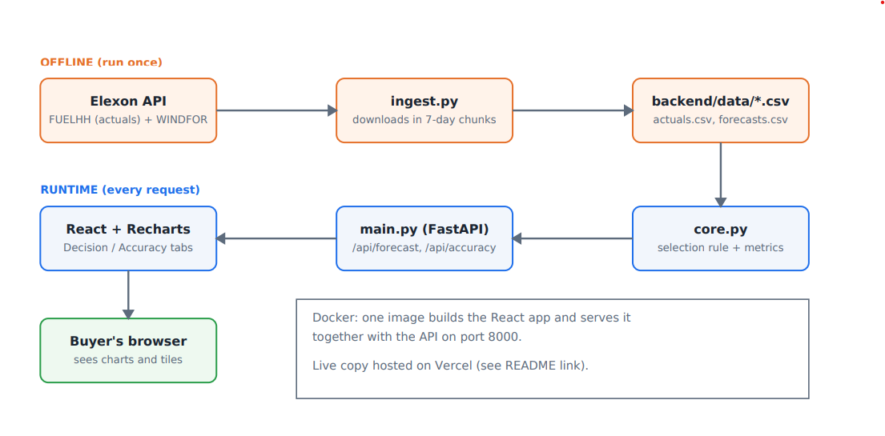

# Day-ahead wind forecast and accuracy tool

A web app for a Great Britain energy buyer who purchases power on the day-ahead market. It answers two questions:

1. **What is the latest wind forecast I could see at the moment I had to decide?**
2. **How accurate have those forecasts been, in numbers, so I can allow for the error?**

Data: national (Great Britain) wind only, from Elexon. Scope: purchase decisions made in **January 2026**, meaning delivery days **2 Jan to 1 Feb 2026**.

## Live app

**https://wind-forecast-day-ahead.vercel.app/**

---

## 1. Files and directories

```
.
├── Dockerfile                 Builds the React app, then serves it together with the API
├── docker-compose.yml         Runs the app container on port 8000
├── requirements.txt           Python dependencies used by the Docker build (fastapi, pandas)
├── .dockerignore              Files excluded from the Docker build
├── .gitignore                 Files excluded from Git
├── README.md                  This file
│
├── backend/                   Python API, calculation logic, data, tests
│   ├── core.py                Core logic: loads data, picks the latest forecast at or before
│   │                          the 09:00 UTC deadline, averages half-hourly actuals to hourly,
│   │                          computes error (forecast − actual) and MAE / RMSE / bias / P10 / P50 / P90
│   ├── main.py                FastAPI app. Endpoints: GET /api/forecast/{day} and GET /api/accuracy.
│   │                          Also serves the built React app from the "static" folder
│   ├── ingest.py              Downloads FUELHH (actuals) and WINDFOR (forecasts) from Elexon
│   │                          and saves them as CSV in data/
│   ├── data/
│   │   ├── actuals.csv        Half-hourly metered wind output (FUELHH)
│   │   └── forecasts.csv      Hourly wind forecasts with publishTime (WINDFOR)
│   ├── requirements.txt       Backend dependencies (requests, pandas, pytest, fastapi, uvicorn, httpx)
│   ├── test_core.py           Unit tests for the selection rule and statistics
│   ├── test_api.py            Tests for the API endpoints
│   └── Analysis scripts (not part of the app):
│       ├── explore.py         First look at the raw Elexon data
│       ├── check.py           Sanity checks on the monthly table and one worked example
│       ├── check_band.py      Measures how often actual output lands inside the likely range
│       ├── diagnose.py        Investigates why the forecast is biased high
│       ├── sensitivity.py     Re-runs results with decision cutoffs from 06:00 to 12:00 UTC
│       └── tune_band.py       Compares likely-range choices (P10–P90, P5–P95, windows)
│
└── frontend/                  React app (Vite + Recharts)
    ├── index.html             HTML entry point
    ├── vite.config.js         Vite config (dev server on port 5173)
    ├── .env.development       Sets VITE_API_URL for local development
    └── src/
        ├── main.jsx           Mounts the React app
        ├── App.jsx            Page layout and the Decision / Accuracy tabs
        ├── DecisionView.jsx   Decision screen: pick a delivery day, see forecast, likely range, actual
        ├── AccuracyView.jsx   Accuracy screen: headline numbers, error by hour, by day, histogram
        ├── useApi.js          Small hook that loads JSON from the API (loading / ok / error states)
        └── index.css          All styling
```

---

## 2. How to start the application

### Option A: Docker (recommended)

Requires Docker.

```
docker compose up --build
```

Then open **http://localhost:8000**. The one container serves both the React website and the API.

### Option B: Run backend and frontend separately (for development)

**Backend** (Python 3.10+):

```
cd backend
pip install -r requirements.txt
uvicorn main:app --reload --port 8000
```

The API is then at http://localhost:8000 (try http://localhost:8000/api/forecast/2026-01-15).

**Frontend** (Node.js 18+), in a second terminal:

```
cd frontend
npm install
npm run dev
```

Then open **http://localhost:5173**. The frontend talks to the API using the `VITE_API_URL` value in `.env.development`; make sure it points to `http://localhost:8000`.

### Run the tests

```
cd backend
pip install -r requirements.txt
pytest
```

### Refresh the data (optional)

The app uses the CSV files already in `backend/data/`, so it does not call Elexon while running. To download fresh data:

```
cd backend
python ingest.py
```

---
## Architecture



Data is downloaded once from Elexon by `ingest.py` and stored as CSV files. While the app is running, the FastAPI backend loads those files at startup, `core.py` applies the selection rule and computes the metrics, and the React frontend shows the results. Docker packages the frontend and backend into one image.

## How it works

For each delivery day, the buyer's decision deadline is **09:00 UTC on the day before**. For every hour of the delivery day, the app takes the **newest forecast published at or before that deadline**. Later forecasts are ignored because the buyer could not have seen them.

That forecast is compared with actual wind output:

- error = forecast − actual (positive means the forecast was too high)
- the app reports MAE, RMSE, bias and the 10th, 50th and 90th percentiles of the error
- the "likely range" on the Decision screen is the forecast shifted by the 5th and 95th percentile of **past** errors, using only hours whose actual output was already known at the deadline

### Screens

- **Decision:** pick a delivery day. Shows the forecast at the deadline, the likely range, and the actual output (known only afterwards) for comparison.
- **Accuracy:** headline numbers for the whole period, plus error by hour of day, by day, and as a distribution.

## Results (2 Jan to 1 Feb 2026, 744 hours)

| Measure | Value |
|---|---|
| Typical miss (MAE) | 2,039 MW |
| RMSE | 2,505 MW |
| Bias | +1,748 MW (forecast too high) |
| Hours where forecast was too high | 85% |
| Likely range: actual inside it | 83% of 696 hours (9% below, 8% above) |

The first two days have no range, because there are not enough earlier results to learn from.

## Assumptions

- **Decision deadline: 09:00 UTC on the day before delivery.** This is an assumption, not a confirmed fact, and is configurable through `cutoff_hour` on the API. Cutoffs from 06:00 to 12:00 UTC gave MAE between 1,901 and 2,039 MW, and the forecast was too high in every case.
- **Time zone:** Elexon times are UTC. In January UK time equals UTC, so no conversion is applied.
- **Hourly comparison:** forecasts are hourly and actuals half-hourly, so each pair of half-hour actuals is averaged.
- **A forecast published exactly at the deadline is allowed.**
- **Likely range:** P5 to P95 was chosen after comparing alternatives on the January data, so it is tuned on this month and not tested on others.

## Limitations

- One month of data, and errors within a day move together, so the figures and range are rough guides, not guarantees.
- The forecast was too high in most hours. The cause has not been established: it could be a real forecast weakness or a difference in what the two datasets measure.
- Wind only, national level. There is no demand or price data, so the app shows wind availability and its uncertainty, not how much to buy.

## Use of AI tools

AI tools were used to build this project, as the assignment allows:

- **Claude (Anthropic):** used to understand the problem and the data and to interpret the results.
- **Cursor:** used to plan the design and structure of the project.

I ran the code and the tests myself and checked the outputs.